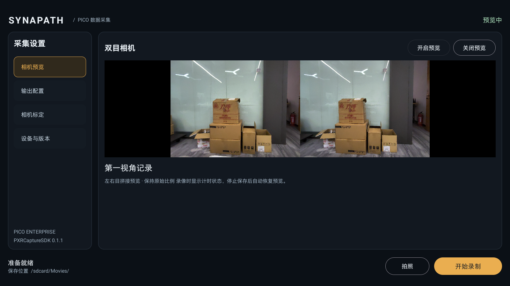
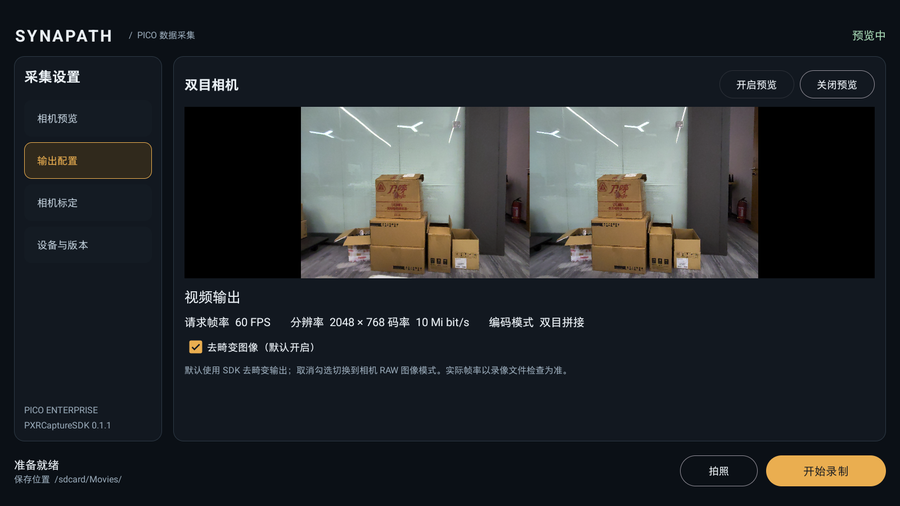
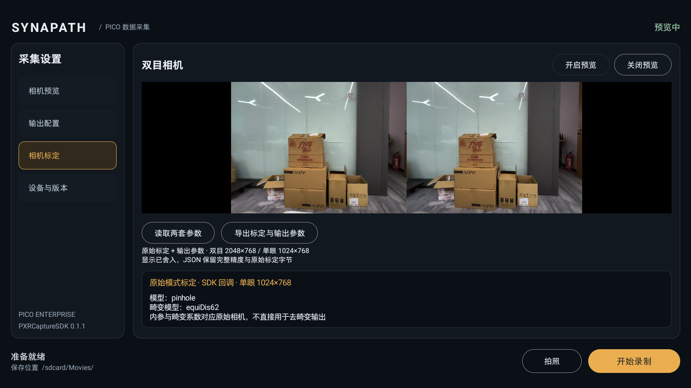

# Synapath PICO — RGB / ToF / head-pose capture

The main branch contains the RGB / ToF / head-pose capture implementation,
developed on `feature/rgb-tof-headpose` from `baseline/sdk-recording-ui3`.
It uses the SDK's original startRecord path. The separate
`feature/app-recording-preview` encoder experiment has not been merged.

## Android 2D interface / 旧版界面

Screenshots of the Android 2D interface on `main`, captured from the PICO
application window in version `0.1.1-sensors.5`. The app is now named
**Synapath PICO**; the interface and capture features are retained.

**双目相机预览 / Stereo camera preview**



<details>
<summary>输出配置与相机标定 / Output settings and calibration</summary>

**输出配置 / Output settings**



**相机标定 / Camera calibration**



</details>

## Capture configuration

The supplied capturelib-0.1.1.aar exposes three recording switches:
`KEY_WRITE_DEPTH_DATA`, `KEY_WRITE_POSE_DATA`, and `KEY_WRITE_CAMERA_PARAMS_DATA`.
This probe enables all three while preserving requested RGB 60 FPS, 2048×768,
SDK undistorted output by default, 10×1024×1024 bit/s and the baseline
enhancement settings. In `0.1.1-sensors.4`, “去畸变图像” is checked on launch;
the app explicitly sets `KEY_OUTPUT_CAMERA_RAW_DATA=VALUE_FALSE`. Unchecking
it requests the SDK camera RAW mode instead. This uses the official Demo's
mode mapping; the app does not add a separate image-remapping pass.

The retained app is **Synapath PICO**, package `com.synapath.picosensors`,
version `0.1.1-2d.2`. It updates the former Synapath PICO Sensors in place,
preserving its permissions and data. The APK is `artifacts/SynapathPico-debug.apk`.

录制开始后主面板隐藏，透明窗口中只显示计时和中央停止圆圈；连续按住圆圈
**2.5 秒**停止并保存，提前松开或移出圆圈取消长按。保存完成后恢复主面板和预览。
这是固定位置的 Android 2D 窗口，不随头部移动。界面移植自
`feature/recording-passthrough-hud`，继续使用当前 SDK 直录管线，保留 RGB、ToF、
Head Pose、共同时间轴校验与两套标定导出；计时和圆圈不会写入相机录像。

Use this one app on the headset. Future updates should retain the same package
identity and display name. Historical Demo, Pipeline and OpenXR experiments
remain available in their Git branches; they are not additional required apps.

```sh
PICO_DEV_IMAGE=operator-origin-dev:local make build
make install
adb shell pm grant com.synapath.picosensors android.permission.CAMERA
adb shell pm grant com.synapath.picosensors android.permission.RECORD_AUDIO
adb shell pm grant com.synapath.picosensors com.picovr.permission.SPATIAL_DATA
adb shell am start -n com.synapath.picosensors/com.picoxr.capturesdkdemo.MainActivity
```

After Stop, version `0.1.1-sensors.3` preserves PXR's existing common timeline
and publishes `/sdcard/Movies/Synapath/Synapath-*.mp4`. No cropping, timestamp
shift, remuxing or sample synthesis occurs. The published MP4 is a byte-identical
copy of the SDK recording, verified by SHA-256 readback before publication.
Wait for the save confirmation. The SDK file remains in
`/sdcard/Movies/.SynapathPending/` for traceability.

The APK reads original MP4 edit lists and checks RGB/pose/ToF vendor time-base
fields. Different first-sample times are preserved. Missing sensor tracks or
inconsistent base fields produce a visible warning, never an invented alignment.
An audit JSON is saved under the app's external files directory in `timelines/`;
the MP4 already contains its original vendor timing and needs no sidecar to
retain the existing track timing. This inspection verifies file-level metadata,
not physical sensor latency or exposure synchronization.
See [timestamp findings](docs/timestamp-audit.md).

Version `0.1.1-sensors.5` shows and exports both calibration sources:

- `raw_camera_calibration`: SDK RAW-mode RGB intrinsics, extrinsics and distortion
  coefficients for the requested single-eye dimensions. Original packed bytes
  are preserved as Base64 and little-endian float64 values.
- `output_image_parameters`: the selected mode's actual SDK calibration callback,
  including per-camera intrinsics/K and packed extrinsics. It uses no fixed-FOV
  projection helper. Camera packing and independent physical projection validation
  remain explicitly distinguished from vendor-reported values.

When undistorted output is selected, startup briefly configures RAW to read its
calibration, then reopens a fresh capture client in undistorted mode to read the second set.
Recording stays disabled during the RAW calibration pass. SDK callbacks are
mode-dependent on firmware 5.15.8; one callback is not mislabelled as both sets.
The calibration page refreshes after mode changes. Each recording freezes both
sets at Start and exports `Synapath-<timestamp>.calibration.json` to
`/sdcard/Download/Synapath/Calibrations/` at Stop, linked to the MP4 SHA-256 and
vendor timeline base. Manual export writes both sets into one JSON there too.
The MP4 and its original vendor calibration remain byte-identical to SDK output.
See [calibration output details](docs/calibration-output.md).

After pulling a recording:

```sh
python3 scripts/analyze-sensors.py video.mp4 --output artifacts/extracted
```

The script identifies pose MIME from MP4 sample descriptions, summarizes packet
PTS, saves pose payloads as seven raw double columns, and exports depth samples
without modifying their bytes. Check `summary.json` rather than relying solely
on configured switches.

Verified worn-state test: RGB 60 FPS; head pose present; 320×240 raw depth
at about 5 Hz (76 distinct samples). A stationary off-head trial produced depth
at about 1 Hz; a later moving off-head trial also reached 5 Hz. Wearing state
alone does not explain the rate. This branch does not force ToF to stay at 5 Hz.
See [SDK capability findings](docs/sensor-capabilities.md).
